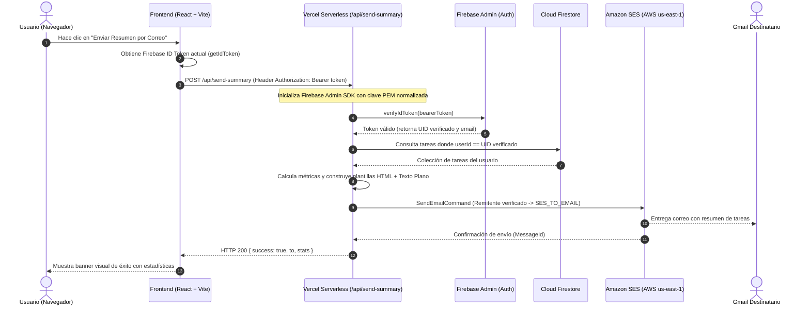

# TaskManager SPA — Proyecto Integrador 4


Aplicación web SPA (*Single Page Application*) moderna, escalable y segura para la gestión de tareas personales en tiempo real, desarrollada con **React**, **TypeScript** y **Vite**, respaldada por **Google Firebase** (Authentication & Cloud Firestore), notificaciones automatizadas por correo electrónico con **Amazon Simple Email Service (SES)** mediante una función Serverless en **Vercel**, y suite de pruebas unitarias y de integración con **Vitest** y **React Testing Library**.

---

##  Aplicación en Producción

* **URL del Despliegue Oficial en Vercel:**  
   **[https://proyecto-m4-guadalupe-villena.vercel.app](https://proyecto-m4-guadalupe-villena.vercel.app)**

* **Repositorio en GitHub:**  
   **[https://github.com/lupevillena/ProyectoM4_GuadalupeVillena](https://github.com/lupevillena/ProyectoM4_GuadalupeVillena)**

---

##  Stack Tecnológico

| Capa | Tecnología | Propósito |
| :--- | :--- | :--- |
| **Frontend** | React 19 + TypeScript | Librería de interfaz reactiva con tipado estático estricto. |
| **Build Tool & Bundler** | Vite 8 | Servidor de desarrollo HMR ultrarrápido y empaquetador de producción. |
| **Enrutamiento** | React Router DOM v7 | SPA con control de historial y guardias de navegación (`ProtectedRoute` y `PublicRoute`). |
| **Autenticación** | Firebase Authentication | Registro e inicio de sesión seguro con correo/contraseña y persistencia de sesión. |
| **Base de Datos** | Google Cloud Firestore | Base de datos NoSQL documental con sincronización en tiempo real (`onSnapshot`). |
| **Backend / API** | Vercel Serverless Functions (`/api`) | Endpoint serverless Node.js aislado para operaciones privilegiadas. |
| **SDK Servidor** | Firebase Admin SDK | Validación criptográfica de Firebase ID Tokens y consultas autorizadas. |
| **Envío de Correos** | Amazon SES (`@aws-sdk/client-ses`) | Servicio de correo en la nube de alta disponibilidad (Región `us-east-1`). |
| **Testing** | Vitest + React Testing Library + JSDOM | Pruebas unitarias y de componentes con mocks controlados. |
| **Linter & Calidad** | Oxlint | Análisis estático de código de alto rendimiento. |
| **Hosting & CI/CD** | Vercel | Despliegue continuo automatizado conectado a la rama `main` de GitHub. |

---

##  Funcionalidades Principales

### 1. Autenticación y Control de Acceso
* Registro de usuarios con validación de contraseña (mínimo 6 caracteres, confirmación coincidente).
* Inicio de sesión con persistencia automática de sesión (recarga sin desconexión).
* Cierre de sesión seguro con redirección a la vista de login.
* Traducción exhaustiva y amigable de códigos de error de Firebase Authentication al español.
* Rutas protegidas: bloqueo de acceso a usuarios no autenticados y redirección automática al Dashboard si ya hay sesión activa.

### 2. Gestión de Tareas en Tiempo Real (Cloud Firestore)
* **Creación:** Formulario accesible con título obligatorio y descripción opcional.
* **Lectura en tiempo real:** Suscripción reactiva mediante `onSnapshot` con limpieza de memoria (*cleanup*) al desmontar.
* **Edición:** Modificación instantánea de título y descripción con sincronización en la nube.
* **Alternar estado:** Marcado de tareas como *Completadas* (con estilo tachado) o *Pendientes*.
* **Eliminación con confirmación:** Cuadro de diálogo modal accesible (`role="dialog"`, soporte de tecla `Escape`) para prevenir borrados accidentales.
* **Filtros por estado:** Pestañas para filtrar tareas (*Todas*, *Pendientes*, *Completadas*) con métricas numéricas.

### 3. Envío de Resumen de Tareas por Correo (Amazon SES)
* Botón en el dashboard para solicitar un resumen de tareas por correo.
* La solicitud se procesa a través de la función serverless segura `/api/send-summary`.
* Construcción del correo en el servidor con formato **HTML responsive** y versión en **texto plano**.
* Muestra de métricas (Total, Pendientes, Completadas) y listado ordenado de las tareas del usuario.
* Feedback visual inmediato: estados de carga (*spinner*), mensajes de éxito con el destinatario verificado y manejo de errores.

---

##  Arquitectura de Seguridad y Flujo de Datos

### 1. Principios de Seguridad
1. **Aislamiento de Secretos (Zero Secrets in Frontend):**  
   Las credenciales de AWS (`AWS_ACCESS_KEY_ID`, `AWS_SECRET_ACCESS_KEY`) y la clave privada de Firebase Admin (`FIREBASE_PRIVATE_KEY`) **nunca se incluyen en variables `VITE_*` ni viajan al navegador**. Residen exclusivamente en el entorno de ejecución serverless de Vercel.
2. **Validación Criptográfica de Tokens (Zero Trust):**  
   El endpoint `/api/send-summary` exige un encabezado `Authorization: Bearer <idToken>`. La función serverless utiliza `verifyIdToken()` de Firebase Admin para verificar la firma digital del token y extraer el `uid` verificado. Jamás se confía en un identificador de usuario enviado en el cuerpo de la petición.
3. **Restricción de Destinatario en Sandbox de Amazon SES:**  
   Dado que la cuenta de SES opera en modo sandbox, el endpoint no acepta un correo arbitrario desde el cliente para evitar abusos o rebotes; despacha exclusivamente a la dirección de prueba verificada en el servidor (`SES_TO_EMAIL`).
4. **Protección en Git e Historial Limpio:**  
   Archivo `.gitignore` configurado rigurosamente para ignorar archivos `.env`, `.env.local`, archivos `.csv` de credenciales IAM, claves privadas `.json`, `.key` y `.pem`. El historial de Git no contiene secretos.

---

### 2. Flujo Completo de Envío de Resumen de Tareas (Amazon SES)



**Paso a paso del flujo:**
1. **Acción del usuario:** En el Dashboard, el usuario autenticado presiona el botón "Enviar Resumen por Correo".
2. **Obtención del token:** El cliente solicita el token de sesión criptográfico (`getIdToken()`) a Firebase Auth.
3. **Petición segura:** El cliente envía una petición `POST` al endpoint serverless `/api/send-summary` con el token en el encabezado `Authorization: Bearer <token>`.
4. **Validación en backend:** La función serverless inicializa el SDK de Firebase Admin (normalizando caracteres `\n` en la clave RSA privada) y valida la autenticidad y vigencia del token con `admin.auth().verifyIdToken()`.
5. **Consulta de datos aislada:** Con el `uid` autenticado y verificado, el backend consulta Firestore buscando únicamente los documentos donde `userId == uid`.
6. **Construcción del mensaje:** El servidor procesa las métricas (total, pendientes, completadas) y genera dos versiones del correo: HTML responsive con diseño corporativo y texto plano como respaldo.
7. **Despacho con AWS SES:** Se inicializa el cliente `@aws-sdk/client-ses` y se ejecuta el comando `SendEmailCommand` hacia la dirección verificada.
8. **Respuesta al cliente:** El servidor responde con código 200 y el cliente actualiza la interfaz mostrando un mensaje de confirmación con las estadísticas enviadas.

---

### 3. Reglas de Seguridad de Cloud Firestore (Recomendadas)

Para garantizar la privacidad y aislamiento de datos a nivel de base de datos, Firestore debe configurarse con las siguientes reglas de seguridad:

```javascript
rules_version = '2';
service cloud.firestore {
  match /databases/{database}/documents {
    match /tasks/{taskId} {
      // Solo el propietario autenticado puede leer, actualizar o eliminar sus propias tareas
      allow read, update, delete: if request.auth != null && request.auth.uid == resource.data.userId;
      
      // Al crear, el userId del documento debe coincidir con el usuario autenticado
      allow create: if request.auth != null && request.auth.uid == request.resource.data.userId;
    }
  }
}
```

---

##  Instalación y Ejecución Local

### Prerrequisitos
* **Node.js** >= v20.0.0
* **npm** >= 10.0.0

### Pasos

1. **Clonar el repositorio:**
   ```bash
   git clone https://github.com/lupevillena/ProyectoM4_GuadalupeVillena.git
   cd ProyectoM4_GuadalupeVillena
   ```

2. **Instalar dependencias:**
   ```bash
   npm install
   ```

3. **Configurar las variables de entorno locales:**  
   Crea un archivo `.env.local` en la raíz del proyecto basándote en `.env.example`:
   ```bash
   cp .env.example .env.local
   ```
   Completa los valores públicos de tu proyecto Firebase (ver siguiente sección).

4. **Iniciar el servidor de desarrollo:**
   ```bash
   npm run dev
   ```
   Abre [http://localhost:5173](http://localhost:5173) en tu navegador.

5. **Compilar para producción localmente:**
   ```bash
   npm run build
   ```

---

##  Variables de Entorno

El archivo `.env.example` detalla las variables requeridas por la aplicación:

### Frontend (Archivo `.env.local` y Vercel Environment Variables)
| Variable | Descripción |
| :--- | :--- |
| `VITE_FIREBASE_API_KEY` | Clave API pública de la aplicación web en Firebase. |
| `VITE_FIREBASE_AUTH_DOMAIN` | Dominio de autenticación de Firebase (`proyecto.firebaseapp.com`). |
| `VITE_FIREBASE_PROJECT_ID` | Identificador único del proyecto en Firebase. |
| `VITE_FIREBASE_STORAGE_BUCKET` | Bucket de almacenamiento de Firebase. |
| `VITE_FIREBASE_MESSAGING_SENDER_ID` | Sender ID de mensajería de Firebase. |
| `VITE_FIREBASE_APP_ID` | Identificador único de la app web en Firebase. |

### Backend / Serverless (Solo en Vercel Dashboard)
| Variable | Descripción |
| :--- | :--- |
| `AWS_ACCESS_KEY_ID` | Access Key de IAM con permisos para `ses:SendEmail`. |
| `AWS_SECRET_ACCESS_KEY` | Secret Key asociada al usuario IAM de AWS. |
| `AWS_REGION` | Región de AWS SES (`us-east-1`). |
| `SES_FROM_EMAIL` | Dirección de correo con identidad verificada en Amazon SES (remitente). |
| `SES_TO_EMAIL` | Dirección de correo verificada para recepción en entorno sandbox (destinatario). |
| `FIREBASE_PROJECT_ID` | ID del proyecto de Firebase. |
| `FIREBASE_CLIENT_EMAIL` | Correo electrónico de la Service Account de Firebase Admin. |
| `FIREBASE_PRIVATE_KEY` | Clave privada RSA de la Service Account de Firebase Admin. |

---

##  Pruebas Automatizadas

El proyecto cuenta con una suite completa de **41 pruebas automatizadas** implementadas con **Vitest** y **React Testing Library**, diseñadas bajo la premisa de aislar servicios externos mediante mocks controlados:

```bash
# Ejecutar todas las pruebas en modo CI / producción
npm test

# Ejecutar pruebas en modo observador interactivo (watch)
npm run test:watch
```

### Cobertura de las pruebas:
* **Autenticación:**
  * Renderizado, validación de formularios, llamada a `loginUser` y `registerUser`.
  * Validación de contraseñas (longitud mínima y coincidencia).
  * Mapeo de errores de Firebase al español (`getFirebaseErrorMessage`).
* **Gestión de Tareas:**
  * Componentes `TaskForm`, `TaskItem`, `TaskList` y `ConfirmModal`.
  * Servicio `taskService`: creación con `serverTimestamp`, actualización protegida sin alteración de `userId`, alternancia de completado y eliminación.
* **Servicio de Envío de Resumen (Amazon SES):**
  * Validación de token de autorización Bearer hacia `/api/send-summary`.
  * Manejo de respuestas exitosas y traducción de errores del servidor sin fugas de secretos.

---

##  Despliegue en Vercel

La aplicación está configurada con despliegue continuo (CI/CD):
1. Cada push a la rama `main` en GitHub dispara una compilación automática en Vercel.
2. Vercel compila los activos estáticos del frontend mediante Vite (`tsc -b && vite build`) y expone la función serverless de la carpeta `api/`.
3. Para la correcta ejecución del envío de correos, las variables de entorno de AWS y Firebase Admin deben encontrarse configuradas en:  
   *Vercel Dashboard > Settings > Environment Variables*.

---

---

## Uso de Inteligencia Artificial (IA) en el Desarrollo

Durante el ciclo de vida de este proyecto, se integró el uso estratégico de herramientas de Inteligencia Artificial como asistente técnico avanzado y mentor de desarrollo de software, elevando los estándares de calidad de código, arquitectura y seguridad.

### 1. Herramientas Utilizadas
* **Antigravity (Google DeepMind):** Entorno y agente de desarrollo con modelo **Gemini 3.8 Flash**, empleado para la planificación arquitectónica, generación de boilerplate tipado, depuración asistida, diseño de suites de pruebas unitarias y auditoría de seguridad del repositorio.

---

### 2. Ejemplos de Prompts Empleados en las Distintas Etapas

A continuación se destacan ejemplos representativos de los prompts estructurados utilizados durante el desarrollo:

* **Arquitectura de Autenticación y Contexto (Hito 1):**
  > *"Diseña una capa de autenticación en React 19 con TypeScript y Firebase Auth v11. Necesito un contexto global `AuthContext` con tipos estrictos, soporte para persistencia de sesión con `onAuthStateChanged`, y componentes de enrutamiento `ProtectedRoute` y `PublicRoute` para evitar accesos no autorizados y redireccionar fluidamente al usuario."*

* **Sincronización en Tiempo Real con Cloud Firestore (Hitos 2 y 3):**
  > *"Implementa un servicio `taskService.ts` desacoplado y un hook personalizado `useTasks.ts` que escuche en tiempo real los cambios de tareas con `onSnapshot`. Las tareas deben estar estrictamente filtradas por `userId` del usuario autenticado. Asegúrate de incluir la función de desuscripción al desmontar el hook para evitar fugas de memoria y ordena las tareas por fecha en el cliente para no depender de índices compuestos en Firebase."*

* **Endpoint Serverless Seguro con Amazon SES (Hito 4):**
  > *"Crea una Vercel Serverless Function en `api/send-summary.ts` que reciba el Firebase ID Token del usuario en el header `Authorization: Bearer <token>`, lo valide criptográficamente con Firebase Admin SDK, obtenga sus tareas desde Firestore en el servidor y despache un resumen formateado en HTML y texto plano usando el SDK v3 de AWS SES (`@aws-sdk/client-ses`). Ninguna credencial de AWS debe exponerse en el cliente."*

* **Resiliencia en el Manejo de Claves Privadas PEM (Hito 5):**
  > *"En Vercel, la variable `FIREBASE_PRIVATE_KEY` puede guardarse con saltos de línea literales `\\n` o reales. Escribe una función de normalización defensiva que maneje ambos casos, elimine comillas accidentales y garantice que el formato PEM sea aceptado sin errores por `admin.initializeApp()`."*

* **Estrategia de Testing Automatizado con Mocks (Hito 6):**
  > *"Configura Vitest y React Testing Library para este proyecto. Diseña pruebas unitarias exhaustivas para autenticación, el CRUD de tareas y el servicio de correo. Utiliza mocks completos de los módulos de Firebase (`firebase/auth`, `firebase/firestore`) y del endpoint de Vercel/AWS SES para que las pruebas corran en milisegundos, sean determinísticas y no consuman cuotas reales ni envíen correos verdaderos."*

---

### 3. Influencia de la IA en la Implementación

1. **Arquitectura por Capas Limpia (Separation of Concerns):**  
   La IA guió la separación del código en módulos independientes: componentes de presentación (`src/components/`), páginas de vista (`src/pages/`), lógica de datos desacoplada (`src/services/`), hooks reactivos reutilizables (`src/hooks/`) y tipado estricto centralizado (`src/types/`).
2. **Tipado Estricto en TypeScript:**  
   Se eliminó por completo el uso de tipos `any`, garantizando contratos de datos sólidos en interfaces como `Task`, `User`, respuestas de la API y argumentos de funciones.
3. **Experiencia de Usuario (UX) y Accesibilidad:**  
   Se estructuraron mensajes de error claros y empáticos en español a partir de códigos nativos de Firebase (`auth/invalid-credential`, `auth/email-already-in-use`), y se aplicaron estándares de accesibilidad WAI-ARIA en modales de confirmación (`role="dialog"`, soporte de tecla `Escape` y bloqueo de scroll).
4. **Resiliencia en Producción:**  
   Detección temprana y solución preventiva de inconsistencias de formato en claves RSA multilínea en funciones serverless.

---

### 4. Decisiones Técnicas Tomadas con Asistencia de IA

* **Autenticación 'Zero Trust' en el Backend:**  
  En lugar de enviar el `userId` en el cuerpo de la petición HTTP (vulnerable a suplantación), la IA recomendó enviar el `idToken` criptográfico y delegar la extracción y verificación del `uid` a Firebase Admin en el servidor.
* **Aislamiento Total de Secretos:**  
  Todas las credenciales de AWS y Service Accounts de Firebase se confinaron exclusivamente en el entorno de ejecución de Vercel, impidiendo su compilación en el código JavaScript de cliente.
* **Ordenamiento de Tareas en Memoria del Cliente:**  
  Para evitar que los evaluadores o nuevos entornos requirieran configurar índices compuestos manuales en la consola de Firestore (`where userId == ... orderBy createdAt desc`), se decidió realizar la consulta filtrada por `userId` y ordenar por fecha cronológica en el hook `useTasks.ts`.
* **Aislamiento Absoluto en Pruebas Unitarias:**  
  Uso de `vi.mock` y `vi.fn()` para simular todas las llamadas asíncronas de Firebase y AWS, permitiendo ejecutar la totalidad de la suite en menos de 3 segundos sin depender de conectividad a internet ni incurrir en costos operativos.

---

### 5. Buenas Prácticas Aprendidas

* **Principio de Menor Privilegio (PoLP):** Configurar usuarios IAM en AWS con políticas estrictamente limitadas a `ses:SendEmail` sobre identidades verificadas.
* **Higiene Rigurosa en Git:** Configurar `.gitignore` antes de inicializar repositorios y auditar el historial de commits mediante búsquedas de patrones para garantizar la ausencia total de credenciales reales.
* **Documentación como Código:** Mantener sincronizados el código, el archivo `.env.example` y la documentación técnica del `README.md`.
* **Testing Automatizado Temprano:** Diseñar pruebas para componentes interactivos y servicios asíncronos como salvaguarda ante regresiones.

---

## Autora

* **Guadalupe Villena** — Proyecto Integrador — Módulo 4
* Repositorio: [github.com/lupevillena/ProyectoM4_GuadalupeVillena](https://github.com/lupevillena/ProyectoM4_GuadalupeVillena)
* Aplicación web: [proyecto-m4-guadalupe-villena.vercel.app](https://proyecto-m4-guadalupe-villena.vercel.app)
